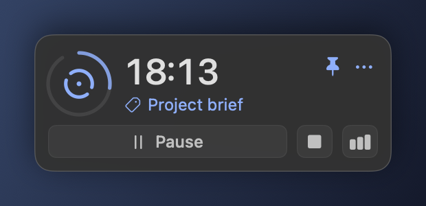
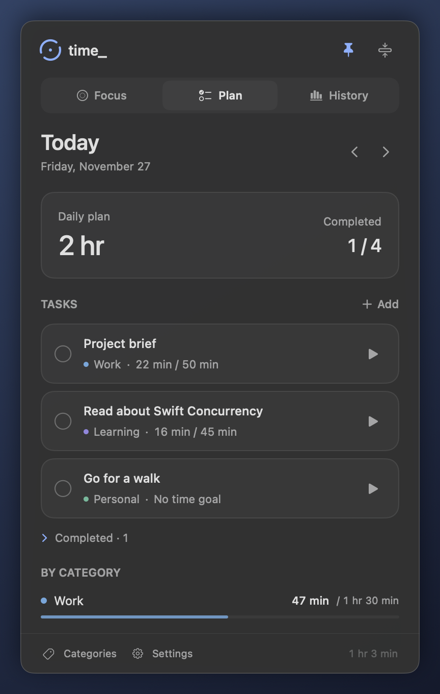
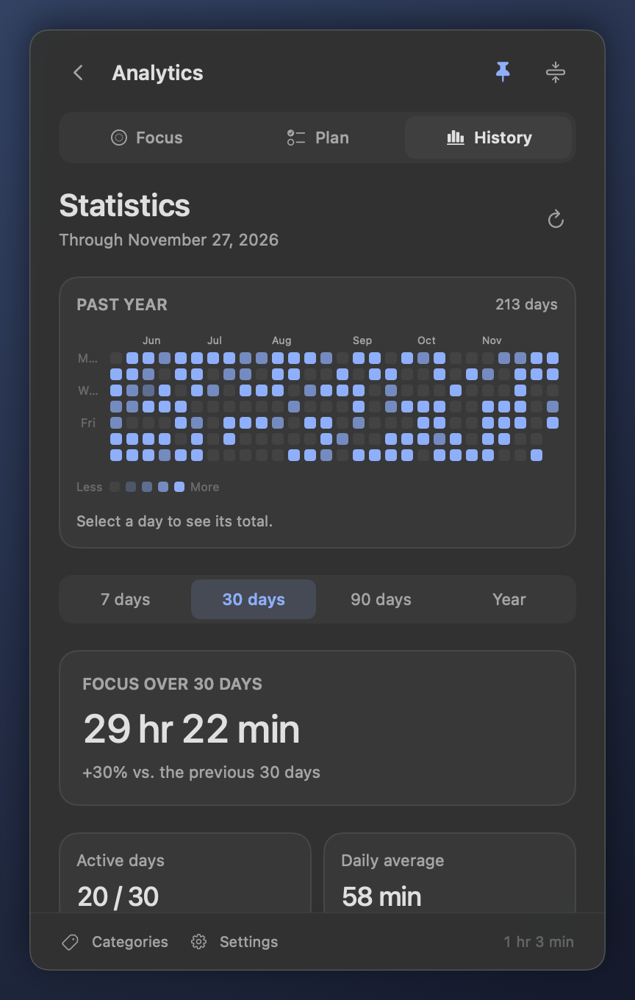

# time_

[Русская версия](README.ru.md)

time_ is a native macOS menu bar app for tracking time and planning your day. Start a focus session from the compact panel or expand it to see your plan, history, and analytics.

**[Download for Apple Silicon (.dmg)](https://github.com/dd0d/time_/releases/latest/download/time_-macOS-arm64.dmg)** · [Releases and checksums](https://github.com/dd0d/time_/releases)

Requires macOS 14 or later.

The download is ad hoc signed and macOS may ask you to allow the first launch. [Build from source](#technical-details)

## Screenshots



| Daily plan | Analytics |
| --- | --- |
|  |  |

## Features

- Stopwatch, countdown, and configurable Pomodoro. Task names are optional.
- Quick category switching, a pinnable panel, and idle time detection.
- One-time and daily tasks with optional time goals. See time tracked by task and category.
- Session history, an activity heatmap, and focus statistics.
- System or custom accent color, adjustable panel transparency, and English and Russian interfaces.

## First launch on macOS

1. Open the downloaded DMG and drag **time_** into **Applications**.
2. Open **time_** from **Applications**.
3. If macOS blocks the launch because it can't verify the developer, open **System Settings → Privacy & Security** and scroll to **Security**. Click **Open Anyway** for **time_** and confirm.
4. Click the **time_** icon in the menu bar to open its panel.

[Apple's first-launch instructions](https://support.apple.com/en-us/102445)

## Technical details

- **App.** SwiftUI views with AppKit for the menu bar item, floating panel, and system appearance.
- **Core.** [RhythmCore](Sources/RhythmCore) handles timer state, recurring tasks, analytics, and persistence. Swift Package Manager builds the app without third-party packages.
- **Data.** Tasks and sessions stay on your Mac in `~/Library/Application Support/Rhythm/ledger.json`. Idle detection reads the macOS counter for time since the last input. It doesn't record your keystrokes.

### Back up or move your data

Open **Settings → Save Backup…** to save tasks, session history, and settings as JSON. On the same Mac or a new one, choose **Restore Backup…** and select that file. time_ keeps a copy of the previous data in its data folder before replacing it. The recovery screen offers the same restore action when time_ can't read its data.

Use **Export History as CSV…** to analyze completed sessions in a spreadsheet. Save a JSON backup before returning to an older build so you can recover edits to recurring tasks when you upgrade again.

### Build from source

Run these commands on Apple Silicon with the Swift 6 toolchain from Xcode or Command Line Tools.

```sh
zsh Scripts/test.sh
zsh Scripts/build.sh
```

Open `dist/time_.app` after the build.

[Release process](docs/releasing.md) · [MIT license](LICENSE)
