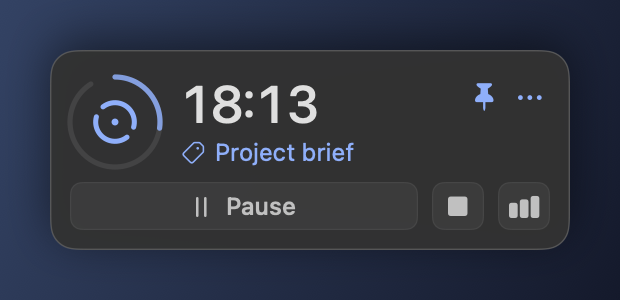
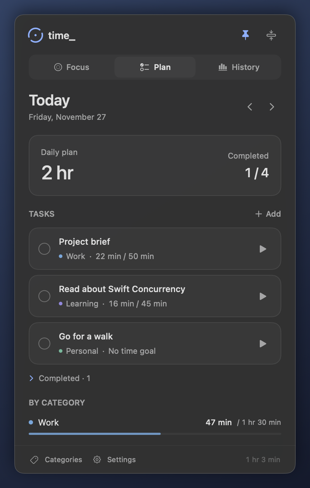
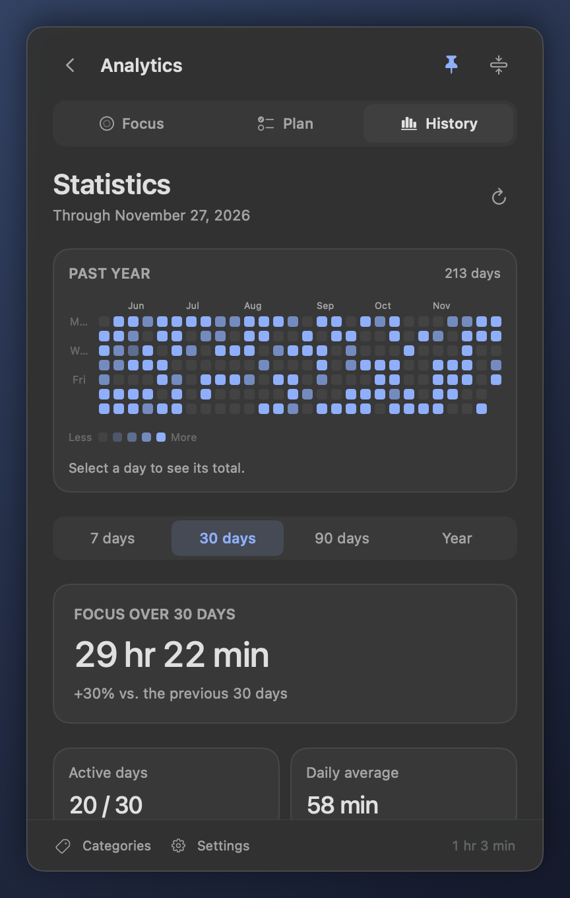

# time_

[English](README.md)

time_ помогает учитывать время и планировать день прямо из строки меню macOS. Запускайте сессию из компактной панели и разворачивайте её, чтобы открыть план, историю и аналитику.

**[Скачать для Apple Silicon (.dmg)](https://github.com/dd0d/time_/releases/latest/download/time_-macOS-arm64.dmg)** · [Релизы и контрольные суммы](https://github.com/dd0d/time_/releases)

Требуется macOS 14 или новее.

## Скриншоты



| План на день | Аналитика |
| --- | --- |
|  |  |

## Возможности

- Секундомер, таймер и настраиваемый помодоро. Название задачи можно пропустить.
- Быстрая смена категории, закрепление панели и обнаружение простоя.
- Разовые и ежедневные задачи с необязательной целью по времени. Видно, сколько времени ушло на задачи и категории.
- История сессий, тепловая карта активности и статистика.
- Системный или свой акцентный цвет, настройка прозрачности, русский и английский интерфейсы.

## Первый запуск на macOS

1. Откройте скачанный DMG и перетащите **time_** в **Программы**.
2. Откройте **time_** из папки **Программы**.
3. Если macOS блокирует запуск из-за неподтверждённого разработчика, откройте **Системные настройки → Конфиденциальность и безопасность** и прокрутите до раздела **Безопасность**. Рядом с сообщением о **time_** нажмите **Всё равно открыть** и подтвердите запуск.
4. Нажмите значок **time_** в строке меню, чтобы открыть панель.

[Инструкция Apple по первому запуску](https://support.apple.com/ru-ru/102445)

## Технические детали

- **Приложение.** Интерфейс на SwiftUI. За строку меню, плавающую панель и системную тему отвечает AppKit.
- **Ядро.** [RhythmCore](Sources/RhythmCore) отвечает за таймер, повторение задач, аналитику и сохранение данных. Проект собирается Swift Package Manager без сторонних пакетов.
- **Данные.** Задачи и сессии хранятся на Mac в `~/Library/Application Support/Rhythm/ledger.json`. В настройках есть экспорт CSV и резервная копия JSON.

Выполните команды на Mac с Apple Silicon и Swift 6 из Xcode или Command Line Tools.

```sh
zsh Scripts/test.sh
zsh Scripts/build.sh
```

После сборки откройте `dist/time_.app`.
